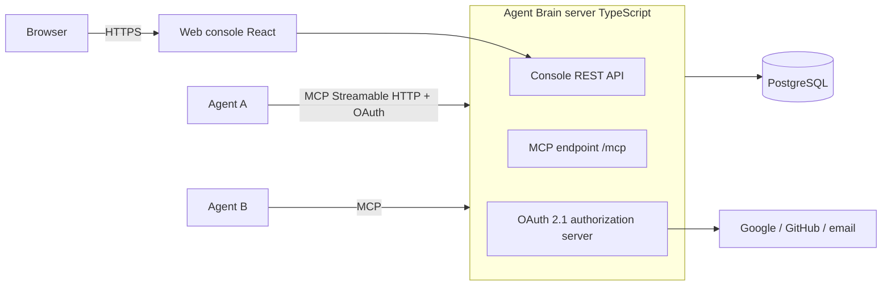

# Agent Brain Design (draft, pending approval)

> Status: draft. Coding starts after the owner approves. 中文版：[design.zh-CN.md](design.zh-CN.md)

## 1. Goal
What you teach one AI agent shouldn't have to be re-taught to the next. Agent Brain is a **cloud-hosted, standard MCP server**: users sign up once, and any MCP-capable agent that adds the server and signs in can **read and write the same training data in real time**.

**Non-goals:** vendor-specific integrations; import/export tooling; end-to-end encryption; team sharing, billing and quotas (v1).

## 2. Basics
- Overseas users first; open source (MIT).
- Sign-in: Google, GitHub, email (magic link / one-time code).
- UI in English and Chinese.
- Free, no quotas in v1. Deployment target TBD by the owner; shipped as Docker, cloud-agnostic.

## 3. What is stored
| Category | Example | On write |
|---|---|---|
| persona | Call me Drew, reply concisely | live immediately |
| memory | Timezone UTC+8, working on project X | live immediately |
| rule | Confirm a plan before writing code | **pending** until the user approves |
| skill | Steps for writing a weekly report | **pending** until the user approves |

Entry fields: category, title, content (Markdown), tags, source agent, timestamps, current version, status (active / pending / deleted).

## 4. Versioning
- Every create/update/delete/revert produces an **immutable version**: actor (agent or user), time, before/after, optional reason.
- Soft delete with restore.
- Conflicts: **last write wins**, history kept; agents can query it.
- Writes may pass `base_version`; if stale, a conflict is returned and the agent decides to merge or overwrite.

## 5. Architecture

- Official MCP TypeScript SDK, **Streamable HTTP** transport.
- Follows the **MCP authorization spec** (OAuth 2.1 + PKCE, dynamic client registration, protected resource metadata) so any compliant client can pop a sign-in page and connect.

## 6. Data model
`users`, `identities`, `agent_clients`, `agent_permissions`, `entries`, `entry_versions` (append-only), `change_log` (monotonic sequence used as sync cursor), `oauth_*` (tokens stored hashed).

## 7. MCP tools
| Tool | Purpose |
|---|---|
| `get_profile` | Full active profile at session start, grouped by category, plus a sync cursor |
| `search_entries` | Filter by category, keyword, tag |
| `get_entry` | Read one entry |
| `create_entry` / `update_entry` / `delete_entry` | Versioned writes; rules and skills land as pending |
| `get_entry_history` | All versions of an entry |
| `list_changes` | Recent changes, filter by time / agent |
| `revert_entry` | Revert to a version (creates a new version) |
| `sync_since` | All changes after a cursor, for mid-session real-time sync |

Also an MCP **resource** (`brain://profile`) with change notifications for clients that subscribe; others poll `sync_since`. Tool descriptions tell agents to call `get_profile` at session start and write back what they learn.

## 8. Safety
- Source agent recorded on every entry and version.
- Behavior-changing categories (rules, skills) are pending until approved, so one agent misled by web or file content can't push a bad rule to every agent.
- Per-agent, per-category read/write permissions; any agent can be revoked.
- Tokens hashed; encryption at rest and in transit.
- Returned content is framed as user data, not instructions, to reduce prompt-injection risk.
- Rate limiting.

## 9. Privacy
Standard encryption at rest (not E2E), enabling search, merge and history. Privacy policy covers what is stored, who can access it, and full export / account deletion.

## 10. Web console v1
Sign-in; browse, search and edit entries; per-entry history and revert; approve pending items; manage connected agents and permissions; EN/ZH switch.

## 11. Phases and owners
| Phase | Scope | Owner |
|---|---|---|
| 1 | Server skeleton, data model, sign-in and OAuth | 小微 |
| 2 | MCP tools, versioning, sync | 小微 |
| 3 | Web console | 小智 |
| 4 | MCP compatibility tests (MCP Inspector and common clients) | 小智 |
| 5 | Deployment (owner provides environment) | together |

Each phase ships on a branch with a PR; the owner decides when to merge.

## 12. Open questions
1. Approve this plan overall?
2. Email sign-in via one-time code / magic link rather than passwords? (recommended)
3. Pick the email provider (e.g. Resend, SendGrid) at deployment time?
