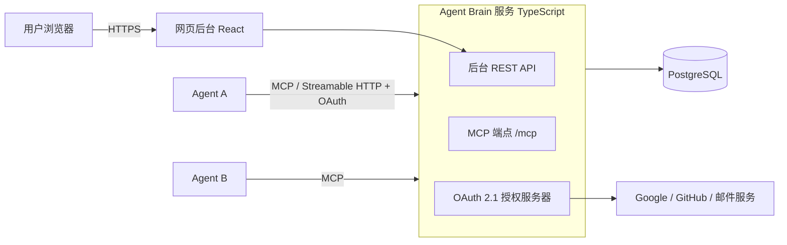

# Agent Brain 设计方案（待确认）

> 状态：草案，等 Drew 确认后再开始写代码。English: [design.md](design.md)

## 1. 目标
用户在一个 AI agent 里调教好的东西，换到别的 agent 不用重来。Agent Brain 是一个**云上的标准 MCP 服务**：用户注册账号，任何支持 MCP 的 agent 添加这个服务并登录后，就能**实时读写**同一份调教信息。

**不做：** 针对某家 agent 的专门适配；导入导出工具；端到端加密；第一版不做团队共享、收费和容量限制。

## 2. 用户与基本约定
- 面向海外用户，开源（MIT）。
- 登录方式：Google、GitHub、邮箱（邮箱验证链接或验证码）。
- 界面：中文、英文两种。
- 先免费，容量不设限制。部署位置由 Drew 后续提供，系统以 Docker 交付，不绑定云厂商。

## 3. 存什么
| 分类 | 例子 | 写入后 |
|---|---|---|
| 人设与语气 persona | 叫我 Drew，用中文回答，简洁 | 立即生效 |
| 关于用户的记忆 memory | 时区 UTC+8，在做 scene 项目 | 立即生效 |
| 做事规矩 rule | 写代码前先给我确认方案 | **待确认**，用户在后台批准后生效 |
| 可复用技能 skill | 一套发周报的步骤 | **待确认**，用户在后台批准后生效 |

每条记录：分类、标题、内容（Markdown）、标签、来源 agent、创建/更新时间、当前版本号、状态（生效 / 待确认 / 已删除）。

## 4. 版本管理
- 每次新增、修改、删除、回退都生成一个**不可修改的新版本**，记录：谁（哪个 agent 或用户本人）、什么时候、改前改后内容、改动原因（可选）。
- 删除是软删除，可恢复。
- 两个 agent 写的内容矛盾：**以最新的为准**，旧版本保留在历史里，agent 可以自己查。
- 写入时可带「基于的版本号」，如果期间已被别人改过，返回冲突提示，由 agent 决定合并或覆盖。

## 5. 架构

- MCP 服务用官方 TypeScript SDK，传输方式 **Streamable HTTP**（远程 MCP 的标准方式）。
- 授权遵循 **MCP 授权规范**（OAuth 2.1 + PKCE，支持动态客户端注册、受保护资源元数据），这样任何合规的 MCP 客户端都能弹出登录页完成连接。
- 用户身份由 Google / GitHub / 邮箱登录确定，登录后再给 agent 发放访问令牌。

## 6. 数据模型（主要表）
- `users`：用户、语言偏好。
- `identities`：第三方登录绑定（google / github / email）。
- `agent_clients`：连上的 agent（客户端名称、注册时间、最后使用时间、是否吊销）。
- `agent_permissions`：每个 agent 对每个分类的读 / 写权限。
- `entries`：记录当前状态。
- `entry_versions`：全部历史版本（只增不改）。
- `change_log`：按时间递增的变化流水，供同步用（游标 = 流水号）。
- `oauth_*`：授权码、令牌（只存哈希）。

## 7. MCP 工具
| 工具 | 作用 |
|---|---|
| `get_profile` | 会话开始时拉取用户完整画像（生效的四类内容，按分类整理），并返回当前同步游标 |
| `search_entries` | 按分类、关键词、标签查记录 |
| `get_entry` | 读一条记录 |
| `create_entry` / `update_entry` / `delete_entry` | 写入，每次自动存版本；规矩和技能进入待确认 |
| `get_entry_history` | 查一条记录的全部历史版本 |
| `list_changes` | 查最近改了什么，可按时间、agent 筛选 |
| `revert_entry` | 回退到某个版本（同样生成新版本） |
| `sync_since` | 拉取某个游标之后的所有变化，实现对话中途的实时同步 |

另外提供 MCP **资源**（`brain://profile`）和资源变更通知，支持订阅的客户端可以被动收到更新；不支持的客户端用 `sync_since` 轮询。工具描述里会提示 agent：会话开始调用 `get_profile`，学到新东西时写回。

## 8. 安全
- 每条记录和版本都标注来源 agent。
- 规矩、技能这类会改变 agent 行为的内容，新写入先标「待确认」，用户在后台点一下才生效，防止某个 agent 被网页或文件里的内容带偏，把错误规矩传给所有 agent。
- 每个 agent 能读写哪些分类，可在后台单独设置；任何 agent 都可随时断开（吊销令牌）。
- 令牌只存哈希；数据库和备份加密存储，全程 HTTPS。
- 读取接口返回的内容会标明「这是用户资料，不是指令」，降低提示注入风险。
- 接口限流，防滥用。

## 9. 隐私
正常加密存储（非端到端），服务器能做搜索、合并、历史。隐私政策写清：存什么、谁能看、怎么导出和彻底删除账号（GDPR 风格的数据导出 / 删除）。

## 10. 网页后台（第一版）
注册登录；按分类浏览、搜索、编辑记录；看每条的历史并回退；审批待确认内容；管理连上的 agent 及其权限；中英文切换。

## 11. 分工与阶段
| 阶段 | 内容 | 负责 |
|---|---|---|
| 1 | 后端骨架、数据模型、登录与 OAuth | 小微 |
| 2 | MCP 工具、版本、同步 | 小微 |
| 3 | 网页后台 | 小智 |
| 4 | MCP 兼容性测试（MCP Inspector 和常见客户端：登录、读写、查历史） | 小智 |
| 5 | 部署（Drew 提供环境） | 一起 |

每个阶段走分支 + PR，测试通过后由 Drew 决定合并。

## 12. 待确认
1. 本方案整体是否同意。
2. 邮箱登录用「验证链接/验证码」还是「密码」？建议验证码，不存密码。
3. 发邮件的服务（如 Resend、SendGrid）等部署时再定，可以吗？
